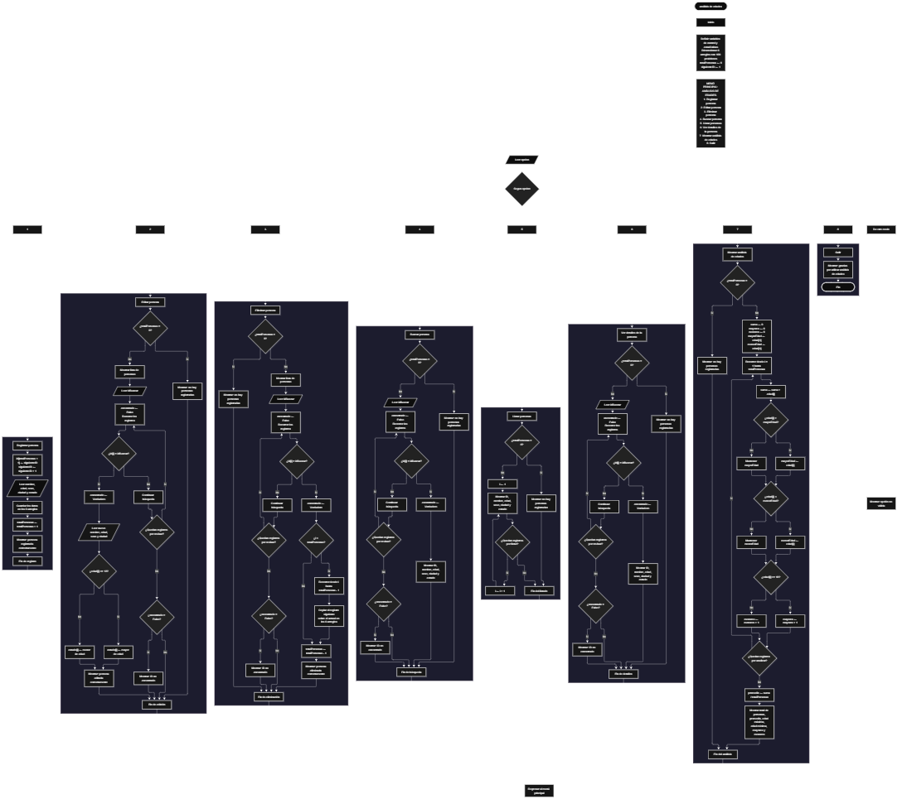

 

Este proyecto, llamado <b>análisis de edades</b>, fue desarrollado en <b>pseint</b> como un ejercicio práctico para fortalecer la lógica de programación mediante la creación de un sistema de gestión de personas desde la consola. El programa cuenta con un menú principal de ocho opciones que permite <b>registrar, editar, eliminar, buscar, listar y consultar los datos completos</b> de las personas registradas, además de generar estadísticas generales sobre sus edades. Cada persona almacena información como el identificador, el nombre, la edad, el sexo, la ciudad y el estado relacionado con su mayoría de edad. Para organizar estos datos, se utilizan seis arreglos con una capacidad declarada de <b>100 posiciones cada uno</b>. Durante su desarrollo se aplicaron conceptos fundamentales de programación, como variables, arreglos, estructuras condicionales, ciclos repetitivos y estructuras de selección, además de procedimientos para buscar, modificar, eliminar y reorganizar registros. Este proyecto permite poner en práctica los conocimientos adquiridos en PSeInt y sirve como base para desarrollar sistemas de gestión y análisis de información más avanzados.

<h2 align="center">⚙️ Funcionamiento del menú principal</h2>

### ➕ Registrar persona

La opción <b>1) registrar persona</b> permite almacenar una nueva persona en el sistema. Para asignar su identificador, el programa utiliza la variable <b>siguienteID</b>, cuyo valor inicial es <b>1</b>. El identificador se guarda en el arreglo <b>id</b>, en la posición siguiente a la cantidad de personas registradas, y posteriormente se incrementa <b>siguienteID</b> en uno para preparar el próximo registro. Después, el programa solicita el <b>nombre, la edad, el sexo, la ciudad y el estado</b> de la persona, almacenando cada dato en la posición correspondiente de su respectivo arreglo. Finalmente, incrementa la variable <b>totalPersonas</b> en uno y muestra el mensaje <b>"persona registrada correctamente."</b>. Aunque los arreglos tienen 100 posiciones declaradas, esta opción no incluye una comprobación que impida registrar personas cuando se alcanza dicha capacidad.

### ✏️ Editar persona

La opción <b>2) editar persona</b> permite actualizar los datos de una persona mediante su identificador. Primero, el programa comprueba si la variable <b>totalPersonas</b> es igual a <b>0</b>. Si no existen registros, muestra el mensaje <b>"no hay personas registradas."</b>. En caso contrario, presenta los datos almacenados de todas las personas, incluyendo su ID, nombre, edad, sexo, ciudad y estado. Después, solicita el identificador de la persona que se desea editar e inicializa la variable lógica <b>encontrado</b> con el valor <b>Falso</b>. Mediante un ciclo <b>para</b>, recorre los registros y compara cada identificador con el valor introducido. Cuando encuentra una coincidencia, cambia <b>encontrado</b> a <b>Verdadero</b> y solicita el nuevo nombre, la nueva edad, el nuevo sexo y la nueva ciudad. A continuación, actualiza el estado según la edad: si es mayor o igual a <b>18 años</b>, establece <b>"mayor de edad"</b>; de lo contrario, establece <b>"menor de edad"</b>. Finalmente, muestra el mensaje <b>"persona editada correctamente."</b>. Si no encuentra el identificador, informa que no se encontró una persona con ese ID.

### 🗑️ Eliminar persona

La opción <b>3) eliminar persona</b> permite eliminar un registro utilizando su identificador. Primero, comprueba si existen personas registradas. Si la lista está vacía, muestra el mensaje <b>"no hay personas registradas."</b>. Si existen registros, presenta sus datos y solicita el ID de la persona que se desea eliminar. La variable <b>encontrado</b> se inicializa con el valor <b>Falso</b> y el programa recorre los identificadores mediante un ciclo <b>para</b>. Cuando encuentra una coincidencia, establece la variable en <b>Verdadero</b>. Si la posición encontrada es anterior a la última posición ocupada, utiliza otro ciclo <b>para</b>, controlado por la variable <b>j</b>, para desplazar hacia atrás los valores de los seis arreglos: <b>id, nombre, edad, sexo, ciudad y estado</b>. Después, disminuye <b>totalPersonas</b> en uno y muestra el mensaje <b>"persona eliminada correctamente."</b>. El código no limpia explícitamente la última posición que queda fuera del total de registros activos. Además, la búsqueda continúa dentro del ciclo después de eliminar el registro, ya que no se utiliza una instrucción para interrumpirlo.

### 🔎 Buscar persona

La opción <b>4) buscar persona</b> permite localizar a una persona mediante su identificador. Primero, el programa comprueba si hay registros almacenados. Si no existen personas, muestra el mensaje <b>"no hay personas registradas."</b>. De lo contrario, solicita el ID que se desea buscar e inicializa la variable lógica <b>encontrado</b> con el valor <b>Falso</b>. A continuación, utiliza un ciclo <b>para</b> para recorrer los registros activos y comparar cada valor de <b>id[i]</b> con el identificador introducido. Cuando encuentra una coincidencia, cambia <b>encontrado</b> a <b>Verdadero</b>, muestra el mensaje <b>"datos encontrados"</b> y presenta el ID, nombre, edad, sexo, ciudad y estado de la persona. Si termina el recorrido sin encontrar coincidencias, muestra el mensaje <b>"no se encontró una persona con ese id."</b>. Esta operación permite consultar los datos de una persona sin tener que mostrar individualmente todos los registros.

### 📋 Listar personas

La opción <b>5) listar personas</b> permite visualizar los datos de todas las personas registradas. Antes de realizar el recorrido, el programa comprueba si <b>totalPersonas</b> es igual a <b>0</b>. Si no hay registros, muestra el mensaje <b>"no hay personas registradas."</b>. En caso contrario, presenta el mensaje <b>"datos registrados"</b> y utiliza un ciclo <b>para</b> desde la primera posición hasta el total de personas almacenadas. Durante cada repetición, muestra el identificador, el nombre, la edad, el sexo, la ciudad y el estado de la persona. Esta función facilita la consulta general de los registros activos y permite revisar la información sin realizar una búsqueda individual.

### 📄 Ver detalles de la persona

La opción <b>6) ver detalles de la persona</b> permite consultar de forma individual todos los datos de un registro. Primero, comprueba si existen personas almacenadas. Si no hay registros, muestra el mensaje <b>"no hay personas registradas."</b>. Si existen personas, solicita el identificador que se desea consultar e inicializa la variable <b>encontrado</b> con el valor <b>Falso</b>. Después, recorre los registros mediante un ciclo <b>para</b> hasta localizar el ID solicitado. Cuando encuentra una coincidencia, establece <b>encontrado</b> en <b>Verdadero</b> y muestra por separado el identificador, el nombre, la edad, el sexo, la ciudad y el estado. Si finaliza la búsqueda sin encontrar el ID, presenta el mensaje <b>"no se encontró una persona con ese id."</b>. Esta opción ofrece una presentación detallada de la información de una persona específica.

### 📊 Mostrar análisis de edades

La opción <b>7) mostrar análisis de edades</b> permite calcular estadísticas generales a partir de las edades registradas. Primero, el programa comprueba si existen personas almacenadas. Si no hay registros, muestra el mensaje <b>"no hay personas registradas."</b>. Si hay información disponible, inicializa la suma de edades y los contadores de mayores y menores de edad en cero. También establece la edad máxima y la edad mínima con el valor de la primera persona registrada. Después, utiliza un ciclo <b>para</b> para recorrer los registros activos, sumar las edades, comparar cada edad con los valores máximo y mínimo y clasificar a cada persona. Si la edad es mayor o igual a <b>18</b>, aumenta el contador de mayores de edad; en caso contrario, aumenta el contador de menores de edad. Al terminar el recorrido, calcula el promedio dividiendo la suma de las edades entre <b>totalPersonas</b>. Finalmente, muestra el total de personas, el promedio de edades, la edad máxima, la edad mínima y las cantidades de mayores y menores de edad.

### 🚪 Salir del menú principal

La opción <b>8) salir</b> permite finalizar el uso del programa y muestra el mensaje <b>"gracias por utilizar analisis de edades."</b>. El menú principal se encuentra dentro de una estructura repetitiva <b>repetir ... hasta que</b>, que permite ejecutar las diferentes operaciones mientras la condición de salida no se cumpla. En este caso, la condición es <b>hasta que opcion = 8</b>, por lo que, al seleccionar la opción 8, el ciclo termina y el algoritmo finaliza. Si se introduce un valor que no corresponde a las opciones definidas, la estructura <b>segun</b> ejecuta el bloque <b>de otro modo</b> y muestra el mensaje <b>"opción no válida."</b>.

<h2 align="center">🧠 Temas aplicados en el proyecto</h2>

### 📦 Variables

En este proyecto se utilizan variables para controlar el menú principal, registrar la cantidad de personas, asignar identificadores, seleccionar registros, comprobar los resultados de las búsquedas y calcular las estadísticas. Cada variable tiene una función específica dentro de las operaciones de gestión y análisis de edades.

🔢 **Opcion:** almacena la opción seleccionada por el usuario en el menú principal.

📊 **TotalPersonas:** indica la cantidad de personas registradas y permite controlar el recorrido de los arreglos.

🆔 **SiguienteID:** almacena el próximo identificador que se asignará a una persona nueva.

🔎 **IDBuscar:** almacena el identificador introducido por el usuario para buscar, editar, eliminar o consultar una persona.

🔄 **I:** funciona como contador en los ciclos que recorren los registros.

🔁 **J:** controla el desplazamiento de los datos durante la eliminación de una persona.

✅ **Encontrado:** variable lógica que indica si se ha localizado una persona con el ID solicitado.

📈 **EdadMinima y EdadMaxima:** están declaradas para representar límites de edad, aunque en el bloque de estadísticas del código se utilizan los nombres `menorEdad` y `mayorEdad`.

➕ **SumaEdades, MenoresEdad, MayoresEdad y AdultosMayores:** variables declaradas para cálculos relacionados con las edades y sus clasificaciones; el bloque de estadísticas utiliza en su lugar los nombres `suma`, `menores` y `mayores`.

👥 **Hombres, Mujeres, Activos e Inactivos:** variables declaradas que no se utilizan en las operaciones actuales del algoritmo.

📊 **PromedioEdad:** variable declarada para el promedio de edades, mientras que el cálculo del código utiliza el nombre `promedio`.

### 🗃️ Arreglos

El programa utiliza seis arreglos, cada uno con <b>100 posiciones declaradas</b>, para almacenar los datos de las personas. Los arreglos comparten el mismo índice, de modo que la posición correspondiente a una persona permite acceder a todos sus datos. Por ejemplo, la información almacenada en la posición <b>1</b> se distribuye entre <b>id[1], nombre[1], edad[1], sexo[1], ciudad[1]</b> y <b>estado[1]</b>. Esta organización facilita el registro, la consulta, la modificación, la eliminación y el análisis de la información.

🆔 **id[100]:** almacena los identificadores de las personas.

📝 **nombre[100]:** almacena los nombres de las personas.

🎂 **edad[100]:** almacena las edades registradas.

👤 **sexo[100]:** almacena el sexo indicado para cada persona.

🏙️ **ciudad[100]:** almacena la ciudad de cada persona.

📌 **estado[100]:** almacena el estado registrado de la persona; al editarla, se actualiza según su edad.

### 🔀 Estructuras condicionales

En el proyecto se utilizan las estructuras <b>si ... entonces</b> y <b>siNo</b> para comprobar si existen personas registradas antes de ejecutar las operaciones, determinar si se ha encontrado un identificador, decidir cuándo desplazar los datos durante una eliminación y clasificar las edades. La condición <b>edad[i] &gt;= 18</b> establece que las personas de 18 años o más son mayores de edad, mientras que las edades inferiores a 18 corresponden a menores de edad. Estas condiciones permiten controlar el comportamiento del programa según los datos almacenados y las decisiones del usuario.

### 🔄 Estructuras repetitivas

El algoritmo utiliza los ciclos <b>para</b> y <b>repetir ... hasta que</b>. Los ciclos <b>para</b> permiten recorrer los registros para mostrarlos, buscarlos, editarlos y calcular las estadísticas. En la eliminación, un ciclo adicional desplaza los datos de las posiciones posteriores para mantener organizados los registros activos. Por su parte, el ciclo <b>repetir ... hasta que</b> mantiene activo el menú principal hasta que el usuario selecciona la opción <b>8</b>. Gracias a estas estructuras, el programa puede procesar varios registros y permitir que se ejecuten distintas operaciones durante una misma sesión.

### 🎯 Estructura según

La estructura <b>segun ... hacer</b> evalúa el valor almacenado en la variable <b>opcion</b> y ejecuta el bloque de instrucciones que corresponde a la selección del usuario. Los casos del 1 al 8 representan las operaciones de registrar, editar, eliminar, buscar, listar, consultar detalles, analizar edades y salir. Además, el bloque <b>de otro modo</b> muestra un mensaje cuando se introduce una opción que no está contemplada en el menú. Esta estructura organiza las funcionalidades del programa y facilita la lectura de las operaciones disponibles.

### 🔢 Dimensionamiento de arreglos

Para reservar las posiciones de almacenamiento, el programa utiliza la instrucción <b>dimension</b> en cada uno de sus seis arreglos. Cada arreglo dispone de <b>100 posiciones declaradas</b>, que se utilizan para guardar los datos de las personas. La variable <b>totalPersonas</b> controla cuántos registros se consideran activos y determina el límite de los recorridos. Sin embargo, el código no contiene una condición que compruebe la capacidad disponible antes de registrar una persona, por lo que el límite de 100 posiciones no está protegido mediante una validación explícita.

### 🔄 Reorganización de registros

Cuando se elimina una persona que no ocupa la última posición activa, el programa utiliza un ciclo controlado por la variable <b>j</b> para copiar los datos de cada posición siguiente sobre la posición actual. Este procedimiento se realiza en los seis arreglos: <b>id, nombre, edad, sexo, ciudad</b> y <b>estado</b>. Después, disminuye <b>totalPersonas</b> en uno para reflejar la nueva cantidad de registros activos. Aunque este mecanismo permite mantener juntos los registros activos, el código no limpia explícitamente la última posición después del desplazamiento. Además, el ciclo exterior de búsqueda continúa ejecutándose después de la eliminación, lo que puede afectar su comportamiento en determinadas circunstancias.

<h2 align="center">¿Cómo se implementaron las operaciones CRUD en el proyecto?</h2>

Las operaciones <b>CRUD</b> se representan mediante las opciones del menú principal. La operación <b>crear</b> corresponde a <b>registrar persona</b>, donde se asigna un identificador y se almacenan los datos en los arreglos. La operación <b>leer</b> se realiza mediante <b>buscar persona, listar personas y ver detalles de la persona</b>, que permiten consultar los registros de diferentes maneras. La operación <b>actualizar</b> corresponde a <b>editar persona</b>, donde se modifican los datos asociados a un identificador. Por último, la operación <b>eliminar</b> permite retirar una persona de los registros activos y reorganizar las posiciones de los datos posteriores. Todas estas operaciones trabajan con arreglos y mantienen la información únicamente durante la ejecución del programa.

<h2 align="center">Diagrama de flujo del proyecto</h2>

<h2 align="center">🛡️ Validaciones del programa</h2>

### 📭 No existen personas registradas

Esta comprobación se utiliza en las opciones de <b>editar, eliminar, buscar, listar, ver detalles y mostrar análisis de edades</b>. El programa evalúa si <b>totalPersonas = 0</b>. Si no hay personas registradas, muestra el mensaje <b>"no hay personas registradas."</b> y evita continuar con el procesamiento que necesita registros existentes. De esta manera, el algoritmo contempla el caso en que el usuario intenta utilizar estas operaciones con la lista vacía.

### 🔎 Persona no encontrada

En las operaciones de <b>editar, eliminar, buscar y ver detalles</b>, el programa utiliza la variable lógica <b>encontrado</b>, que se inicializa con el valor <b>Falso</b> antes del recorrido. Si encuentra un registro cuyo ID coincide con el solicitado, cambia la variable a <b>Verdadero</b>. Si termina el recorrido sin encontrar coincidencias, muestra el mensaje <b>"no se encontró una persona con ese id."</b>. Esta comprobación permite informar al usuario cuando el identificador introducido no corresponde a una persona localizada entre los registros activos.

### 🎂 Clasificación por edad

La clasificación por edad se realiza durante la edición de una persona y en el cálculo de las estadísticas. La condición <b>edad[i] &gt;= 18</b> identifica a las personas mayores de edad, mientras que las edades inferiores a 18 se cuentan como menores de edad. Durante la edición, el campo <b>estado</b> se actualiza automáticamente con el texto correspondiente. En cambio, al registrar una persona, el programa solicita el estado directamente al usuario, sin comprobar que coincida con la edad introducida.

### ⚠️ Capacidad de los arreglos

Los seis arreglos tienen <b>100 posiciones</b>, pero el código no comprueba explícitamente si <b>totalPersonas</b> ha alcanzado ese límite antes de realizar un nuevo registro. Por ello, aunque existe una capacidad declarada, no hay una validación que impida intentar almacenar datos más allá de las posiciones previstas. Esta característica corresponde al funcionamiento del código original y debe tenerse en cuenta si se desea ampliar o mejorar el sistema posteriormente.

### 🔢 Opción no válida

La estructura <b>segun</b> contiene el bloque <b>de otro modo</b>, que muestra el mensaje <b>"opción no válida."</b> cuando el usuario introduce una opción que no corresponde a los casos definidos en el menú. El ciclo principal termina únicamente cuando la variable <b>opcion</b> toma el valor <b>8</b>, que es la opción de salida presentada al usuario.

### 🆔 Identificadores consecutivos

El programa utiliza la variable <b>siguienteID</b> para asignar un identificador a cada persona nueva. Después de asignarlo, incrementa su valor en uno. Cuando se elimina una persona, el identificador no se reutiliza automáticamente, porque el contador no se reduce ni se vuelve a calcular a partir de los registros activos. Esto permite que las personas registradas posteriormente reciban identificadores consecutivos respecto al contador de la sesión, aunque existan identificadores de registros eliminados.

<h2 align="center">🎯 Objetivo del proyecto</h2>

El objetivo principal de este proyecto es fortalecer la <b>lógica de programación</b> mediante el desarrollo de un sistema de gestión y análisis de personas en <b>pseint</b>. A través de su construcción se aplican conocimientos sobre variables, arreglos, estructuras condicionales, ciclos repetitivos y estructuras de selección, integrándolos para registrar, consultar, actualizar y eliminar información. Además, el proyecto permite comprender cómo recorrer conjuntos de datos, reorganizar registros y obtener estadísticas como el promedio, la edad máxima, la edad mínima y la cantidad de personas mayores y menores de edad. De esta manera, constituye una base para desarrollar sistemas de gestión y análisis más completos utilizando otros lenguajes de programación y tecnologías.

